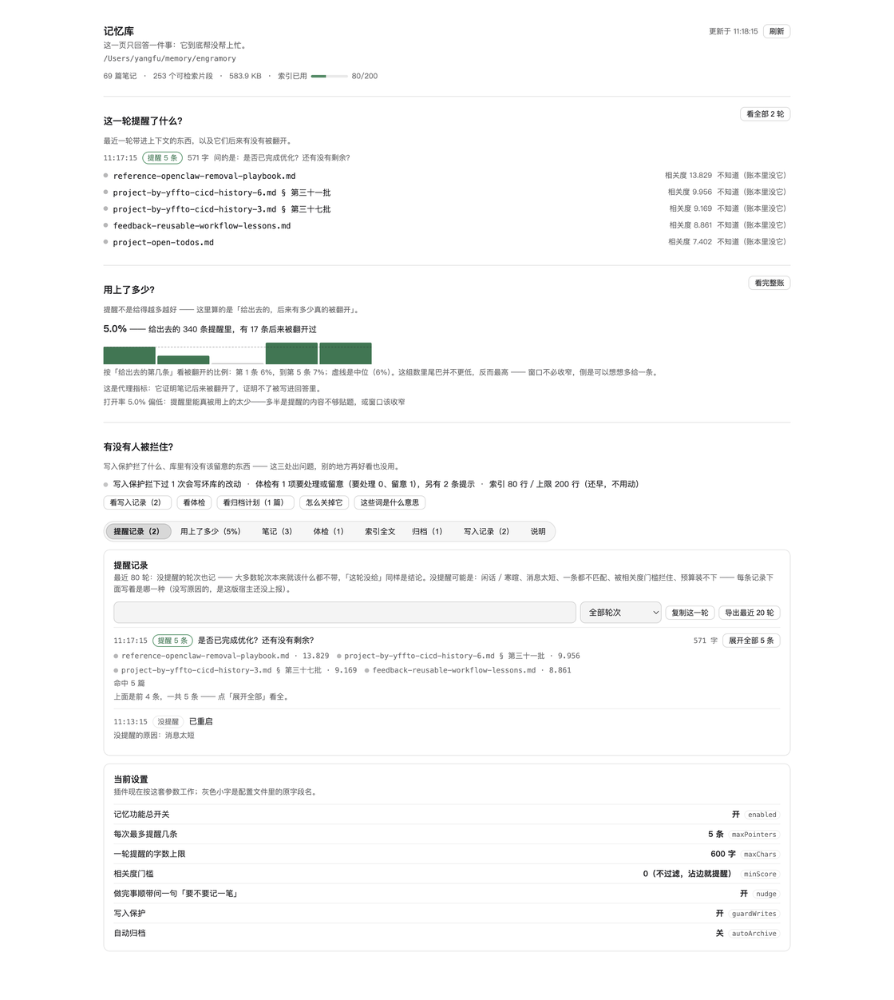

# dsh-engramory-recall

[](https://www.npmjs.com/package/dsh-engramory-recall)
[](LICENSE)
[](https://unstone.github.io/dsh-xray/registry.html#yffo__dsh-engramory-recall)
[English →](README.en.md)

> **记忆库就在磁盘上，可模型每轮都像失忆** —— 除非你亲口提醒它「你先读一下记忆」。
> 装上这个插件：相关的老笔记会在**每一轮自己浮上来**（最多 4 条提醒、总共不超过 480 字），
> 不用你再手动投喂。

一条命令装上（重启一次宿主生效）：`dsh plugin --profile desktop add dsh-engramory-recall`

[DeepSeek Harness](https://github.com/deepseek-ai/deepseek-harness) 的**本地记忆插件**。记忆库就是一份普通 markdown 文件夹（默认 `~/memory/engramory`），
布局遵循本仓库自己维护并冻结的 **Format v1**（[`docs/format.md`](docs/format.md)）—— 它**借鉴**了
[Engramory 协议](https://github.com/tinqiao-oss/engramory)（MIT）「一事一文 + 索引当小抄 + 索引有硬上限」的路子，
规范文本与实现都在这边：**检索、注入、账本、写入闸门、归档、体检、面板、MCP 全部自研**，与上游没有共享代码
（借用部分的版权与出处见 [`THIRD-PARTY-NOTICES.md`](THIRD-PARTY-NOTICES.md)）。
全部用 `node:` 内置模块实现：**零第三方依赖、零网络、默认零模型调用、零常驻进程**。

## 这是什么

用 markdown 攒长期记忆的人都会撞上同一堵墙：**记是记下来了，可 agent 不会自觉去翻。**
每次都得你手动说一句「你先读一下记忆」——不读，就等于没记。

这个插件补的就是这一步。装上之后，会发生三件事：

1. **不用再自己翻记忆。** 你正常说话就行：相关的老笔记会自己跟上来，在这一轮里多出一条
   「可能相关的既有条目」——文件名 + 命中的那一行片段 + 一句「需要细节自己 `read`」。
   模型顺着它去读原文，你不必再当那个提醒它翻笔记本的人。
2. **只在对的时候出现，而且永远有上限。** 没命中就一个 token 都不注入；命中最多 4 条、
   一轮最多 480 字符（两个数都能调）。「继续」「嗯」「好的」这类寒暄直接放行，零开销。
3. **看得见有没有用上。** 会话里多一个「记忆」标签页：这轮为什么提醒 / 为什么没提醒、
   提醒过的后来有没有被打开、库里有哪些笔记、写得干不干净，都在里面。

顺带还管住三件事（都能关）：**写入保护**（不合规的笔记当场拒写）、**静态体检**（20 项检查，
只报告不动手）、**可逆归档**（把「第 N 批」这类追加式章节整段搬进 `-history.md`，不删历史）。

有几个词，下面统一说人话：

| 你可能看到的词 | 人话 |
|---|---|
| **注入** / 注入一条 | 提醒。把「库里有这几篇相关的」顺手塞进这一轮 |
| **指针** | 一条提醒：一篇笔记的文件名 + 命中的那一行片段 |
| **打开率** | 提醒被用上的比例 —— 提醒了 N 条，后来真的被读了几条 |

`maxPointers` / `maxChars` 这些只是它们的键名，配置表里都给了人话名。

## ✨ 特性

| | 特性 | 人话说明 |
|---|---|---|
| 🧠 | 每轮自动想起 | 在每个用户轮的开头检索一次，命中就顺手提醒模型「库里有这几篇相关的」 |
| 🎯 | 带的是那句话，不是提问的回声 | 注入行按 IDF 挑正文里的句子，标题/描述复述用户问话要被折扣；公开口径「地基句保住率」39.6% → **85.4%** |
| 💸 | 没命中就是不花 | 命中了才塞指针，没命中一个 token 都不注入；寒暄（「继续」「嗯」）连检索都不做 |
| 🔒 | 数据不出本机 | 只需要文件读写权限，不要网络；不建库、不生成索引文件、明文 markdown 可读可 diff |
| 🙅 | 不替你写，也不替你删 | 不往库里写东西、没有自动遗忘、没有自动合并；归档只搬走，不删除 |
| 🎚️ | 硬上限 | 一轮的字符数、条数、索引体积都有天花板，且超限是**拒绝**，不是悄悄截断 |
| 🛡️ | 写入保护 | 不合规文件名 / 缺 frontmatter / 疑似真实密钥，写进来的那一刻就被打回并留审计 |
| 🗄️ | 可逆归档 | 追加式章节搬进 `<笔记>-history.md`，先备份、两段式确认，没有一步不可逆 |
| 🩺 | 体检器 | 20 项检查：孤儿笔记、索引重复、失联路径、超 100KB、待办 30 天没更新、「带进上下文 20 次一次没被读过」、**索引快满了该压哪几行**… |
| 🧹 | 消费侧门控 | 带进上下文很多次、一次都没被读过的笔记会被降权（默认），证据确凿的才移出注入；「过期」只降权不拦 —— 旧不等于没用 |
| 📊 | 打开率账本 + 记忆周报 | 每次提醒、每次被打开都落一行 JSONL；`npm run recall:stats` 看账，`npm run recall:report` 出一页人话周报（谁在干活、花了多少上下文、「本轮一个字都没进」也可见） |
| 🖼️ | 一页人话面板 | 「记忆」标签页：**首屏三问**（这一轮提醒了什么 / 用上了多少 / 有没有人被拦住）接着八个页签看明细；只读、每 3 秒自刷新，另有术语表和「我要的功能在哪个开关上」两张清单 —— 看不懂的仪表盘等于没有面板 |
| 🧩 | 别的宿主也能蹭 | `mcp.js` 是零依赖的 stdio MCP 服务器：五个只读工具 + 索引资源 + 两个提示（`recall` / `curate`），同一份库挂给 Claude Code / Codex / Cursor |

## 🚀 怎么用

前提：装好了 DeepSeek Harness（`dsh` 命令可用）。三条命令，复制就能跑：

```bash
# 1) 装（profile 名按你的环境：桌面端是 desktop，网页端是 web）
dsh plugin --profile desktop add dsh-engramory-recall

# 2) 重启一次宿主（网页端重跑 dsh web；桌面端退出 App 再打开）—— 配置会热重载，代码不会

# 3) 用一阵子之后查账：注入了几轮、被打开几次、哪些轮次零命中
cd ~/.dsh/profiles/desktop/node_modules/dsh-engramory-recall && npm run recall:stats

# 4) 想要一页人话周报（谁在干活、花了多少上下文、这块记忆值不值）
npm run recall:report -- --days 30
```

装完就该有的样子：

- **会话里多一个「记忆」标签页**（和「对话 / 轨迹」并排）：首屏先给三个结论，下面八个页签看明细；
- **说一句和记忆库里某篇笔记相关的话**，这一轮就会多出一条「可能相关的既有条目」；
- 说「继续」「嗯」这种话，**什么都不多** —— 这是设计，不是坏了。

从源码装也行（把上面的第 1 条换成）：

```bash
dsh plugin --profile desktop add /path/to/dsh-engramory-recall
```

卸载：

```bash
dsh plugin --profile desktop remove dsh-engramory-recall
```

> 装完请确认 profile 的 `node_modules/dsh-engramory-recall` 软链指向真实目录 —— 断链时宿主只会打印
> 一行 `skipping profile bundle`，插件整轮不加载却什么都不报。细节和另一个坑见
> [docs/release.md](docs/release.md)。

## 🖼️ 面板长什么样



> 图是面板真实渲染的离屏截图（宽 1120px，浅色主题），不是设计稿；深色主题下同一份代码会跟着宿主换色。

首屏只回答三个问题，答完才轮到明细：

1. **这一轮提醒了什么？** —— 最近一轮带进上下文的笔记、相关度，以及每条**后来有没有被翻开**
   （状态点来自账本的累计打开记录，和「用上了多少」同一份口径，不是估算）；
2. **用上了多少？** —— 打开率，以及「给出去的第几条更容易被用上」的柱状图（虚线是中位），
   并明说这是**代理指标**：它证明笔记被翻开过，证明不了被写进回答；
3. **有没有人被拦住？** —— 写入保护拦了几次、体检有几项要处理或留意、索引**已用多少 / 上限多少**行
   （上限读配置 `indexMaxLines`，并直接说「还早，不用动」还是「快满了，该压缩了」）。

下面八个页签是明细：**提醒记录**（每轮判定，可按类型筛选、复制/导出）、**用上了多少**（打开率、位置级曲线、
预算与分数、没注入的原因分布、`minScore` 代价曲线、门控降权与抑制的账 + 四句判据）、**笔记**、**体检**、**索引全文**、
**归档**（计划 + 一键执行）、**写入记录**、**说明**（术语表 + 「我要的功能在哪个开关上」+ 每个数字的来源）。

面板是**只读**的观测窗：所有数字都来自本地文件（账本 `.engramory-recall.jsonl`、审计
`.engramory-audit.jsonl`、索引与笔记本身），一个都不估。取不到这条路由时（Electron 走
`file://` + IPC）召回照常工作，面板只会停在一行「正在读取记忆库状态…」加上「宿主路由不可用」。

## ⚙️ 配置

改 profile 的 `cordis.patch.yml`（和上面一样，改完重启一次最稳）：

```yaml
- insert:
    - id: engramory-recall
      name: dsh-engramory-recall
      config:
        enabled: true
        storePath: ~/memory/engramory    # 留空 = 插件不工作（安全默认）
        maxPointers: 4                   # 每次最多提醒几条
        maxChars: 480                    # 一轮提醒的字数上限
        nudge: true                      # 做完事顺带问一句要不要记录
        guardWrites: true                # 写入保护
        autoArchive: false               # 自动归档（默认关，见下）
```

常用的几个旋钮，人话版：

| 人话名 | 键名 | 默认值 | 什么意思 |
|---|---|---|---|
| 每次最多提醒几条 | `maxPointers` | `4` | 一轮里最多注入几条指针。实测 4→5 只买 1.7 个点，4→6 一个点都不买 |
| 注入策略 | `recallMode` | `push` | 命中之后往上下文里放什么：`push` 照旧推最多 `maxPointers` 条 / `hybrid` 只推最靠前的 1 条 / `pull` **一条指针都不推**，只留一句「库里有 N 条线索，需要时用 `engramory_search` 自己查」。`pull` 在本轮一条都不匹配时保持沉默（没命中就不出声）；默认值已用 7.1 判分器量过（工具回路**四臂**：`none`/`push`/`hybrid`/`pull`，`hybrid` 已于 2026-10-17 补测），**结论是维持 `push`**：`hybrid` 只省一半注入（110 → 57 token），代价是**确定性地丢掉 22.6 个点的指针召回**（86.8% → 64.2%），而它的调用率（34–38%）仍与 `push`（24–30%）同档，并没有像 `pull`（96–98%）那样把主动检索救回来 —— 理由与数字见 [docs/measuring.md](docs/measuring.md) |
| 一轮提醒的字数上限 | `maxChars` | `480` | 提醒文本的硬上限（字符）。装不下时先塌缩成只剩文件名，不会静默丢 |
| 相关度门槛 | `minScore` | `0` | 调高能滤掉弱命中、少些噪音，代价是可能漏；代价曲线在面板里能看 |
| 消费侧门控 | `gate` | `assist` | 让「带进上下文很多次、一次没被读过」的笔记往后排。`off` 不干预 / `shadow` 只记账不改 / `assist` 降权（默认）/ `enforce` 移出注入 |
| 做完事顺带问一句 | `nudge` | `true` | 「长期记住」意图提示；长会话一次都没写过库时也提醒一次（`sedimentMinTurns`，默认 12 轮） |
| 写入保护 | `guardWrites` | `true` | 不合规文件名、缺 frontmatter、疑似真实凭据一律拒写，并写审计 |
| 自动归档 | `autoArchive` | `false` | 打开后归档自动跑（仍先备份、仍过闸门）。默认关：归档是改库，建议先手动点几轮 |
| 记忆库路径 | `storePath` | `~/memory/engramory` | 支持 `~`。**留空则插件不工作** —— 不猜路径，是刻意的 |
| 召回账本 | `usageLog` | `true` | 每次注入 / 打开多写一行到 `<storePath>/.engramory-recall.jsonl`，打开率的数据源 |
| 索引上限 | `indexMaxLines` / `indexMaxBytes` | `200` / `25600` | `MEMORY.md` 长过这个就**拒绝写入**（索引每轮都读，超限部分会被静默不再召回） |
| 召回读多少 | `maxNotes` / `maxBytes` | `2000` / `4194304` | 一次召回最多读多少篇 / 多少字节（防病态目录的护栏）。**超出的笔记不进检索**，不是「排后面」—— 库大到这条线时，体检、首屏与 `engramory_status` 都会把差额说出来 |
| 总开关 | `enabled` | `true` | 关掉它只需改成 `false` |

其余键（查询预算、轮换降权、去重、语义开关…）连同默认值在
[docs/how-it-works.md](docs/how-it-works.md#配置) 的完整表里。

## 🩹 常见问题

**Q：装完了，好像什么都没发生？**
先看「记忆」标签页在不在 —— 在就说明加载成功了，没提醒大概率是这轮本就不该提醒（见下一条）。
不在的话：确认 profile 里的软链没断（断链只打印一行 `skipping profile bundle`，静默失败），
重启一次宿主，再跑 `npm run check` 看它怎么说（配置键认不认、库路径对不对、装的是哪一份）。

**Q：为什么这轮没提醒我？**
三种情况都是正常的沉默：**寒暄/空/短于 4 字**（「继续」「嗯」「好的」「ok」）直接放行、连检索都不做；
**检索了但没命中**；**命中了但没过 `minScore`**。想知道到底是哪种，看「记忆」标签页的「提醒记录」，
或 `npm run recall:stats` 的原因分布（`chitchat` / `too-short` / `duplicate` / `store-not-configured` /
`index-empty` / `no-hits` / `below-min-score`）。库里确实没有相关笔记时，它不会编一条出来。

**Q：我的记忆会离开这台机器吗？存在哪？**
不会。`capabilities` 只要文件读写，不要 network；它只读你的 markdown，不建数据库、不生成索引文件，
**默认零模型调用**。只有你显式打开语义开关时才会走宿主已经配好的模型 —— 插件自己不配 key、不直接出网。
库就是那个文件夹，可以 git、可以手改、可以给别的工具共用。

**Q：为什么我的索引 `MEMORY.md` 写不进去？**
超过 200 行 / 25KB 会被**直接拒绝**（拒绝理由里写着「203 行 > 200」这类原话），磁盘零字节变化。
故意这么设计的：索引是每轮都要读的东西，超限的部分不会被静默地不再召回 —— 它连长都长不上去。
把索引改短的重写能过，体检器也会把超限报出来。

**Q：索引快满了怎么办？**
三步，都能自己做：① 面板「记忆」→「归档」页签执行归档（先备份，把长笔记的历史块搬进
`<笔记>-history.md`）；② 压长行 —— 索引一行只该是「一句短钩子 + 链接」，体检的
`index-long-lines` 会按长度点名最该压的那几行；③ 整篇重写一份更短的（**缩小的重写永远放行**，
可以一步一步压）。体检也不会等到被拒才说话：到 90% 就报 `index-near-cap`（warn），已经超限报
`index-over-cap`（error）。改完看面板首屏「索引已用 x / 上限」。

**Q：写入保护能拦住模型乱写吗？**
能拦住 `write` / `edit`：文件名不合规、缺 frontmatter、疑似真实凭据（私钥块 / `sk-` / `ghp_` /
`AKIA` / `xox` / JWT）当场拒，拒绝理由直接回给模型，后续监听器翻不回来。但它**不是沙箱**：
`bash` 重定向它看不见，兜底靠体检器定时扫（真实抓到过两篇绕过闸门的裸 markdown）。
不信这段话可以两分钟自己验：让它往 `MEMORY.md` 追加 130 行、写一个 `bad-name.md`、
写一篇带 `api_key: sk-…` 的笔记 —— 三次都该被拒，且磁盘上零字节变化。

**Q：自动归档会不会把我的历史删掉？**
不会。它只搬追加式章节（`## 第 N 批` 这类），搬进同目录的 `<笔记>-history.md` —— 仍在库里、
仍能被召回；动手前原件备份到 `.archive-backup/<时间戳>/`；而且是两段式：先出计划，你点「执行」才动库。
`autoArchive` 默认关，就是让你先手动点几轮再决定。

**Q：面板上的「打开率」能证明记忆被用上了吗？**
它是**代理指标**，不是因果证明。打开率 = 去重后的打开条数 ÷ 注入指针条数（同一条指针在同一轮被
读多次只算一次 —— 分子分母得同一个量纲，否则能印出「打开率 150%」）。它回答「提醒有没有被顺着读」，
回答不了「读了就一定有帮助」。别拿它当护身符，这也是面板里还要给四句判据的原因。

**Q：要不要打开语义检索 / 语义增强？**
默认全关，不开就是纯词面：中文按「单字 + 相邻双字」切分，配一张 177 条的手工同义表 ——
**换一种说法就会漏检**，这是它已知的短板。语义那两档要么多花模型 tokens、要么每次检索多一个外部依赖，
所以做成显式开关，装完不会自己调模型去改你的笔记。想开的话看
[docs/limits.md](docs/limits.md) 里两节可选项。

**Q：`dsh plugin add` 失败，但报错说的是一个跟它无关的包？**
`dsh plugin` 是**全有或全无**的：它每次都会重装 profile 的整个依赖集，只要有一个 spec 解析不了
（版本被下架、被供应链策略拦住、指向已删路径），添或删任何插件都会一起失败，而且报错说的是那个无关的包。
排查看 `.plugin-manager/logs/operation-*/pnpm.log`，别盯被操作的那个包。

**Q：我只用 Claude Code / Codex / Cursor，能用吗？**
能，但**只读**：`mcp.js` 是一个零依赖的 stdio MCP 服务器（`engramory-recall-mcp` 命令），
挂上之后对面拿到五样东西：`engramory_search`（检索）、`engramory_read`（读原文）、
`engramory_status`（确认读的是哪个库）、`engramory_list`（先看库里有什么）、
`engramory_usage`（账本摘要）；再加一个索引资源 `engramory://index` 与两个提示
（`recall` 先搜再答、`curate` 把这次会话里定下来的事实整理成草稿）。
一条命令挂进 Claude Code：`claude mcp add engramory -- engramory-recall-mcp --store ~/memory/engramory`。
写入治理留在家用版里 ——
别的宿主没有那套守卫接口，硬做等于把 fail-closed 的闸门换成一句口头约定。
见 [docs/release.md](docs/release.md#别的宿主mcp-服务器只读)。

## 🗂 架构

一句话的数据流：**你的消息 → 可检索性门控 → BM25 检索（同义扩展 / IDF 选词）→ 命中才注入一条
`role: user` 的插件消息（文件名 + 命中片段）→ 每次注入与打开落一行账本**。检索是纯本地的词面计算，
默认不碰模型；注入量受 `maxPointers` / `maxChars` 约束，装不下就塌缩成只剩文件名。

面板走插件自己注册的**只读**路由 `GET /api/engramory-recall/state`（每 3 秒轮询；体检与归档计划有
30 秒缓存，不重算全库），执行归档是另一条必须 `POST` 的路由。取不到这条路由时（比如 Electron 走
`file://` + IPC）召回照常工作，只是没有面板数据。

| 文件 | 干什么 |
|---|---|
| `index.js` | 插件入口：每轮 pre-step 召回、注册工具与只读路由 |
| `bm25.js` | 词面检索：中文切分、IDF 选词、177 条同义表、超大笔记切桶 + 长度归一 |
| `store.js` | 读记忆库与索引（markdown 是唯一真相源，不建第二份存储） |
| `guard.js` / `audit.js` | 写入闸门（fail-closed）+ `.engramory-audit.jsonl` 审计 |
| `index-guard.js` | 索引上限闸门（200 行 / 25KB 拒绝写入） |
| `doctor.js` | 20 项静态体检，只报告不动手 |
| `archive.js` | 追加式章节 → `<笔记>-history.md`，先备份、两段式 |
| `usage.js` + `scripts/recall-stats.mjs` / `scripts/recall-report.mjs` | 打开率账本、`npm run recall:stats` 明细、`npm run recall:report` 周报 |
| `client/client.js` | 「记忆」标签页（手写 bundle，不需要构建工具） |
| `mcp.js` | 给别的宿主的零依赖 stdio MCP 服务器（只读）：五工具 + 索引资源 + 两个提示 |
| `skill.js` | 注册 `engramory` 技能：什么时候该记、什么时候不该记 |

### 🔍 别人怎么体检我们

[dsh-xray](https://github.com/unStone/dsh-xray) 每天静态扫描 `dsh-plugin` 话题下的全部插件（一万八千多个），
只读代码、不执行，给每个插件出一张**能力卡**。我们那张卡是
[**C2 · 3 flags**](https://unstone.github.io/dsh-xray/registry.html#yffo__dsh-engramory-recall)，三条标记逐条对得上：

| 扫描器看到的 | 是什么 |
|---|---|
| `runtime_patch · cordis.patch.yml` | 配置示例文件（默认参数），不是偷偷改运行时 |
| `exec_tooling ×18` | 全部在 `bench/` 里 —— 基准尺子会起子进程，**这些文件不进 npm 包** |
| `net_server_tooling ×2` | 同上，在 `bench/embed-live.mjs`（试真·语义检索的实测脚本） |
| outbound domains: `api.openai.com` / `api.mistral.ai` / … | **可选**语义检索后端的地址：默认关闭，开了才会出网 |
| env: `ENGRAMORY_STORE` / `ENGRAMORY_SEMANTIC_PROVIDER` | 我们的两个开关：库路径、语义后端选谁 |

原则就一句：**我们的能力面欢迎别人读**。想自己验，扫描器是开源的（`scanner/`），也可以直接读
[`docs/limits.md`](docs/limits.md) 里我们自陈的短板。

## 🛠 开发

```bash
git clone https://github.com/yffo/dsh-engramory-recall.git && cd dsh-engramory-recall
npm test            # 全套测试：分词 / BM25 / 门控 / 闸门 / 体检 / 归档 / 面板渲染 / MCP / 脏数据 fuzz
npm run check       # 接线自检：配置键认不认、库路径对不对、装的是哪一份、包清单漏没漏文件
npm run bench:check # 合成基准对账（CI 跑的就是它，和 bench/expectations.json 比）
npm run bench:foundation -- --check  # 地基句尺子：写进上下文的那一行里有没有决定性那句话
npm run probe       # 召回质量探针：3 组 query + 三道对照，跑在真实记忆库上
npm run recall:report -- --days 30   # 记忆周报：谁在干活、花了多少上下文、哪些轮次一个字都没进
```

这几条要在**克隆下来的仓库里**跑：npm 包里只发了插件自己需要的文件和 `scripts/recall-stats.mjs`、
`scripts/recall-report.mjs` 这两个脚本，`test/`、`bench/` 都没发；只有 `npm run recall:stats` 与
`npm run recall:report` 在已安装的插件目录里也能跑。
全部命令（十几个基准尺子）在 [docs/release.md](docs/release.md#测试与自检)。

## 📚 文档

| 文档 | 什么时候看 |
|---|---|
| [docs/format.md](docs/format.md) | **格式规范（Format v1）**：目录长什么样、一篇笔记有哪些字段、上限与治理、与上游规范的差异 |
| [docs/how-it-works.md](docs/how-it-works.md) | 想弄清它内部到底怎么跑、每个旋钮什么意思（含完整配置表）、代价对照 |
| [docs/measuring.md](docs/measuring.md) | 想看数字：四条选型否决线、跟同类插件的对照、**四把可复算的尺子**（含「地基句保住率」39.6% → 85.4% 的对照与消融）。公开数据集 LongMemEval-S 500 题上 RecallAny@1 **89.2%**（教科书 BM25 同口径 86.2%），合成基准 hit@1 50.4% vs 43.2% |
| [docs/limits.md](docs/limits.md) | **最该读的一份**：底线、真正的短板、路线图，以及十四条被实测证伪的路 |
| [docs/release.md](docs/release.md) | 安装 / 卸载的坑、测试与自检的全部命令、发版流程与发布排错表、别的宿主用 MCP |
| [CHANGELOG.md](CHANGELOG.md) | 每个版本改了什么 |
| [THIRD-PARTY-NOTICES.md](THIRD-PARTY-NOTICES.md) | 与上游 Engramory 协议的关系、借用与对齐范围、上游许可原文 |

## 📄 License

[MIT](LICENSE)
